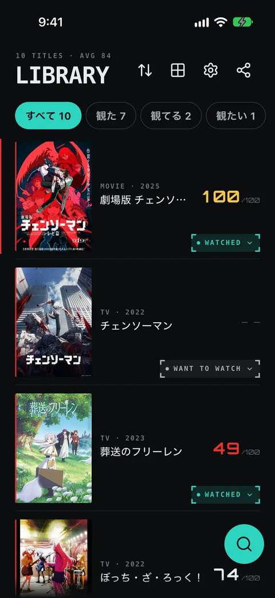
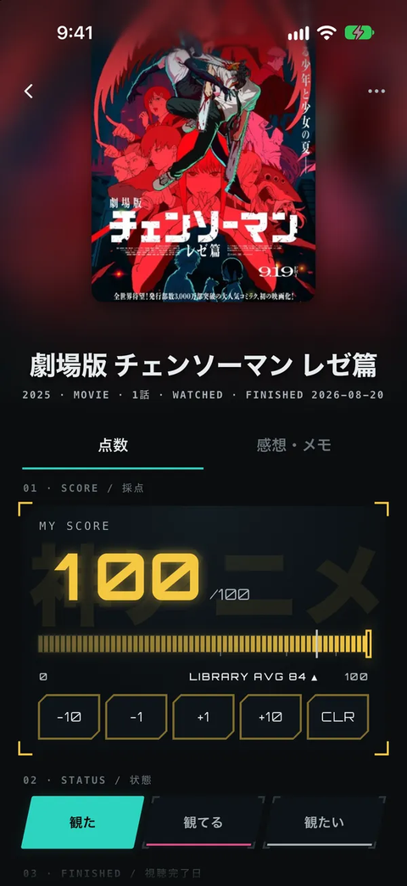

# Gen（4arms）

Flutter で iOS アプリと OSS を作っています。個人開発アプリ「アニ100」の開発と運営が中心です。
いまはエンジニアとして働ける場を探しながら、個人開発を続けています。

✍️ Zenn: [zenn.dev/4arms](https://zenn.dev/4arms)

## 📱 アニ100 — 100点満点のアニメ記録アプリ（iOS）

[App Store](https://apps.apple.com/jp/app/id6767991451) ／ [ani100.com](https://ani100.com)

アニメを 0〜100 点で記録する、自分だけの記録アプリです（SNS 機能なし・アカウント不要・広告なし）。
星5段階だと「星3寄りの星4」と「星5寄りの星4」が同じ星4になってしまう。その差を残したくて作りました。

  
  

### アニ100 でやったこと

企画・設計・実装・リリース・運営まで1人で担当し、2026 年に App Store で公開。現在バージョン 1.9.0 で、継続的にアップデートしています。

**要望から生まれた機能・改善**

- App Store レビューの「見終わった日付を記録して、日付順に並べられるようになったらもっと便利」→ 視聴完了日の記録と、視聴完了日順の並び替えを追加
- 「検索が弱い」という報告 → 検索を Cloudflare Worker に移し、アプリの審査を待たずに検索の直しを届けられるようにした。「銀魂」のような2文字のタイトルが検索できない問題や、海外作品にカバー画像が付かない問題の改善もこの土台の上で進めた
- 使っていての摩擦の改善：詳細画面の変更の自動保存（「更新する」を押し忘れると変更が消えていた）、一覧の行から直接ステータスを変更、点数を編集して戻ってもスクロール位置が戻らないように

**そのほかの機能追加**

- 記録を画像でシェアする共有カード
- 記録のバックアップ（iCloud）
- 同じアニメの各期をまとめるシリーズ機能（ベータ）
- アプリ内の更新履歴と、新しいバージョンを知らせるダイアログ

技術構成： Flutter / Riverpod / freezed / go_router、feature-first のレイヤー分離。作品データは AniList・Annict・MyAnimeList から取得し、検索と共有リンクは Cloudflare Workers で処理しています。

## 📦 その他の公開物

- **[cupertino_typography](https://pub.dev/packages/cupertino_typography)** — Apple HIG の 11 テキストスタイルを Flutter の TextStyle として提供するパッケージ。Flutter の iOS デフォルト文字組みをエンジンのソースまで掘って調べた[調査記事](https://zenn.dev/4arms/articles/flutter-ios-typography-chimera)から生まれました
- **[agent-plugins](https://github.com/4armsxlr8/agent-plugins)** — AI エージェントと開発するための自作プラグイン集。仕様決めから検証までを1本のフローで進める plan 駆動開発の crystallize と、Riverpod 向けのアーキテクチャ違反検査 flutter-riverpod-guardrails

## 学び直していること

ソフトウェアテスト、RDB と SQL を土台にした設計、セキュリティの基礎。
